<!--
  This README is a stack of generated SVG cards. Do not hand-edit the cards.
  Content lives in config.json; run `python scripts/render_cards.py` to rebuild.
  The daily Action in .github/workflows/profile-cards.yml refreshes the data.
-->

  
  
  

  
  

  
  

  
  

<!-- Plain text below: readable where images are blocked, and indexable. -->

  <b>Dnyanesh Chandewar</b> — AI systems builder and quant developer. Founder of
  <a href="https://www.cybercore.in/">CyberCore</a>, building agentic AI for startups since 2019.
  &nbsp;·&nbsp; <a href="https://dnyaneshchandewar.com">Site</a>
  &nbsp;·&nbsp; <a href="https://www.linkedin.com/in/dnyaneshchandewar/">LinkedIn</a>
  &nbsp;·&nbsp; <a href="https://dnyanesh.substack.com">Newsletter</a>
  &nbsp;·&nbsp; <a href="mailto:chandewardnyanesh@gmail.com">chandewardnyanesh@gmail.com</a>

